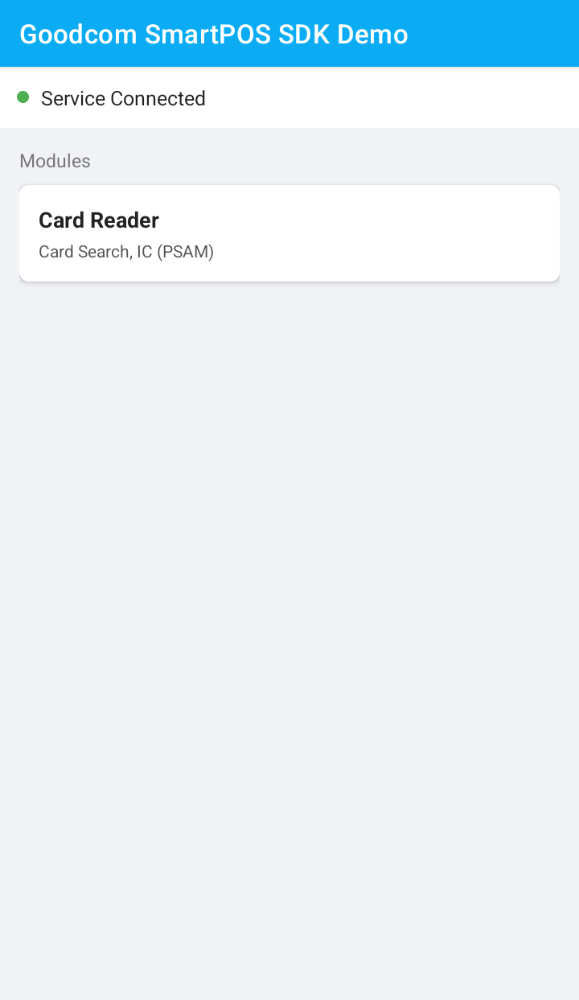

This app demonstrates how to use Goodcom's financial POS device SDK, which supports IC cards, NFC cards, magnetic stripe cards, and PSAM cards.
<p float="left">
  

</p>

# Getting Started

Import the SDK library in the app's build.gradle file: 
```javascript
implementation("cn.goodcom:smartpossdk:1.+")
```

## Import in code
Declare GcSmartPosHelper where the SDK is used
```javascript
import com.goodcom.possdk.GcSmartPosHelper;
```

## Initialize SDK
Initialize and bind the SDK service before using the SDK's API methods.
```javascript
GcSmartPosHelper.get().init(this, new ConnectCallback() {
    @Override
    public void onConnectPaySDK() {
        //test(); // Call the API for operating on pos
    }

    @Override
    public void onDisconnectPaySDK() {
    }
});
```

## Use api
Use GcSmartPosHelper to operate the POS system using relevant APIs, such as reading IC cards, NFC cards, magnetic stripe cards, and PSAM cards.
